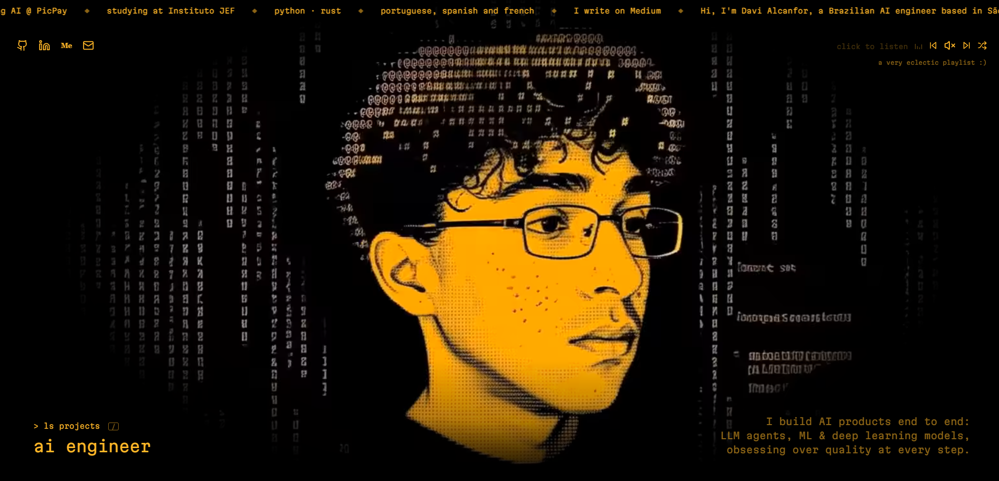

<div align="center">



# Davi Alcanfor

AI engineer based in São Paulo

**[alcanfor.vercel.app](https://alcanfor.vercel.app)**

[LinkedIn](https://www.linkedin.com/in/davi-alcanfor/) · [Medium](https://medium.com/@alcanfordavi) · [Email](mailto:alcanfordavi@gmail.com)

</div>

---

## About

Personal portfolio: a single page with a full-screen video background, glitch text,
a YouTube-powered music player and a terminal-style projects window (press <kbd>/</kbd>).

## Stack

- [Astro](https://astro.build) + TypeScript
- Plain CSS, no UI framework
- ~3 KB of client-side JavaScript

## Getting started

```sh
npm install
npm run dev     # http://localhost:4321
npm run build   # type check + static build
```

## Structure

| Path | Purpose |
| --- | --- |
| `src/data/site.ts` | All content: texts, links, playlist, projects |
| `src/components/` | Page sections, one component each |
| `src/lib/scramble.ts` | Glitch text effect |
| `public/` | Background video, images and icons |

## Credits

Inspired by [Ruben Marcus](https://www.rubenmarcus.dev)'s portfolio.

## License

[MIT](LICENSE)
